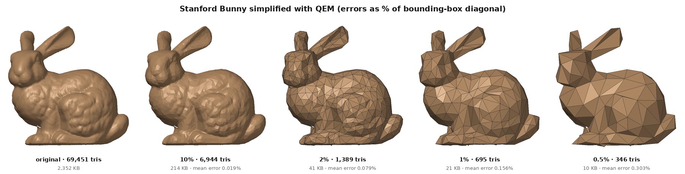
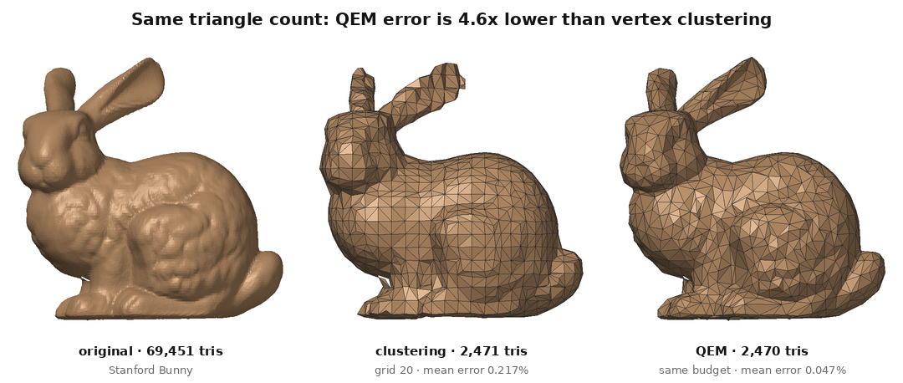

# meshkit: the pitch

*Daksha Mehta, B.Tech IT, ABV-IIITM Gwalior. Computer Graphics course project.*

## In one line

I built a tool that removes 98% of a 3D model's triangles while keeping its shape within 0.079%
of its size on average, and that turns a blocky model into a smooth one, all from scratch.

## The 60-second version

3D scans and artist models often have hundreds of thousands of triangles, which is too many for
a phone, a browser or a VR headset to draw quickly, and the files are large. I implemented the
standard solution, Garland and Heckbert's quadric error metric simplification, in Python and
NumPy without any mesh library. On the Stanford Bunny it goes from 69,451 triangles and 2,352 KB
to 1,389 triangles and 41 KB, and the surface moves by only 0.079% of the model's size on
average. I also implemented Loop subdivision, which goes the other way and smooths a coarse mesh,
and a way to measure how far two surfaces are apart. Against a simple baseline, vertex
clustering, my simplifier's error is 3.0 to 4.6 times lower at the same triangle count. Then I
switched off each part of the algorithm in turn to see what it is for. The main thing I learned is
that most of the work is not the formula but keeping the mesh valid and measuring it honestly.

**30-second version.** I wrote a mesh simplifier and a subdivision-surface tool from scratch. It cuts
the Stanford Bunny from 69,451 to 1,389 triangles, and from 2,352 KB to 41 KB, with a mean surface
error of 0.079%. It beats a standard baseline by 3.0 to 4.6 times, it has 26 tests, and every
result is reproducible from one script and viewable in 3D on the project's web page.

## The problem it solves

- **Level of detail in games and VR:** an object far from the camera covers a few pixels, so
  drawing all 69,451 triangles of the bunny for it wastes time. Engines keep several simplified versions and
  switch between them.
- **Scanned models on the web and in AR:** a model of a few megabytes is slow to download on a phone.
- **Concrete example from my results:** the bunny at 2% of its triangles is 41 KB instead of
  2,352 KB (98.3% smaller), and the mean error is 0.079% of its bounding-box diagonal.

## What I built

- **QEM simplifier** (`mesh/quadrics.py`, `mesh/simplify.py`): greedy edge collapse with a priority
  queue, lazy deletion, the link condition, a fold check and boundary-preserving planes.
- **Loop subdivision** (`mesh/subdivide_loop.py`), including the boundary rules.
- **Error measurement** (`mesh/metrics.py`): random surface samples, exact point-to-triangle
  distance, mean and approximate Hausdorff distance in both directions.
- **Baseline**: vertex clustering, for a fair comparison at the same triangle count.
- **Ablation study**: six experiments, each switching off or changing one part of the algorithm.
- **Software renderer** for all result images, following the viewing pipeline from our lectures.
- **26 automated tests**, a command-line tool, and **one script** (`run_experiments.py`) that
  regenerates every image, table and number.
- **An interactive web viewer** on GitHub Pages (three.js) with a level-of-detail slider.
- **GitHub Actions**: tests on Python 3.10 to 3.12, and a workflow that re-runs the experiments when
  the algorithm changes and opens a pull request, so GitHub's image diff shows how the output changed.

## Results

| Model, level | Triangles | File | Mean error | Max error |
|---|---|---|---|---|
| Bunny, original | 69,451 | 2,352 KB | | |
| Bunny, 10% | 6,944 | 214 KB | 0.019% | 0.179% |
| Bunny, 2% | 1,389 | 41 KB | 0.079% | 0.675% |
| Bunny, 1% | 695 | 21 KB | 0.156% | 1.071% |
| Spot, 2% | 116 | 3 KB | 0.618% | 5.088% |
| Fandisk, 2% | 258 | 7 KB | 0.027% | 0.437% |

Errors are percentages of the bounding-box diagonal. At grid size 20 the clustering baseline
gives 2,471 triangles with a mean error of 0.217%; QEM with the same budget gets 0.047%, 4.6
times lower. Over five sizes from 368 to 14,421 triangles, QEM's error is 3.0 to 4.6 times lower.

## What I learned beyond the syllabus

| Concept | What it means, in one line | Where it is in my code |
|---|---|---|
| Quadric error metric | squared distance to a plane is vᵀ(ppᵀ)v, and these 4×4 matrices simply add up | `mesh/quadrics.py` `face_quadrics`, `vertex_quadrics` |
| Optimal vertex placement | minimise the quadric by solving a 3×3 system, with a guard against unstable solves | `quadrics.py` `optimal_point` |
| Edge collapse | merge the two ends of an edge into one vertex; two triangles vanish | `simplify.py` `_collapse` |
| Priority queue with lazy deletion | a heap of edge costs; outdated entries are skipped using version numbers | `simplify.py` `run` |
| Manifolds and the link condition | the two vertices may share only as many neighbours as faces, or the surface pinches | `simplify.py` `_passes_link_condition` |
| Euler characteristic | V − E + F = 2 − 2·genus − holes; if it changes, the topology broke | `mesh/mesh.py` `euler_characteristic` |
| Preventing face flips | reject a collapse if any surviving face's normal turns too far | `simplify.py` `_causes_fold` |
| Boundary constraints | extra planes standing on hole rims stop holes from growing | `quadrics.py` `add_boundary_quadrics` |
| Subdivision surfaces, Loop's weights | split each triangle in four and average with Warren's weights β | `mesh/subdivide_loop.py` |
| Catmull–Clark and B-splines (theory) | Catmull–Clark reproduces bicubic B-spline patches on regular quad meshes; Loop does the same for quartic box splines on triangles | README, "How it connects to the course" |
| Point-to-triangle distance | seven regions (3 corners, 3 edges, face), from Ericson's book | `metrics.py` `closest_point_on_triangles` |
| Approximate Hausdorff distance | the largest of many sampled surface-to-surface distances | `metrics.py` `shape_error` |
| Area-weighted surface sampling | pick a triangle by area, then a uniform point with the sqrt trick | `metrics.py` `surface_samples` |
| Baselines and ablation studies | compare with a simple method; switch parts off one at a time | `run_experiments.py`, `results/07_ablations/` |
| NumPy vectorisation and profiling | batch the solves and the fold check; measure before claiming speed-ups | `optimal_points_batch`, `_causes_fold`, DEVLOG |
| Automated testing | 26 pytest tests on topology, geometry and measurement | `tests/` |
| CI and image diffs | GitHub Actions runs tests and opens a results PR with changed images | `.github/workflows/` |
| three.js and GitHub Pages | a WebGL viewer with no build step | `docs/` |

## How it builds on what we studied

| Lecture topic | How the project uses it |
|---|---|
| Polygon meshes (vertex, edge, face lists) | the whole project works on vertex and face arrays; edge lists and vertex→face tables are built from them |
| Splines, B-splines | Loop subdivision is the triangle version of B-spline refinement; its boundary rule is exactly the cubic B-spline rule 1/8, 3/4, 1/8 |
| Quadric surfaces | the error metric is a quadratic form in homogeneous coordinates |
| 3D transformations, homogeneous coordinates | rotations in the renderer; planes stored as 4-vectors [a, b, c, d] |
| Viewing pipeline, window-to-viewport | orthographic projection, fitting the model's box to the image, flipping y |
| Lighting model (ambient, diffuse, specular) | two lights plus a Blinn-Phong highlight in `render/renderer.py` |
| Flat and Gouraud/Phong shading | flat shading in the images; flat/smooth toggle in the web viewer |
| Back-face culling, painter's algorithm | used for every result image; turned off for open meshes like Suzanne |
| Raster displays | triangles are filled into a raster image at 2× size and filtered down to anti-alias |

## Problems I hit and how I solved them

All of these are in [DEVLOG.md](DEVLOG.md) with more detail.

1. **A fake 8.9% error on a perfect model.** Measuring distance with the 16 triangles whose centres
   are nearest fails on long thin triangles, which simplified CAD faces are full of (aspect
   ratio up to 460). On Fandisk at 20% this reported a max error of 8.866%; using the minimum of
   that and a second, sample-based bound gives 0.293%, which matches what the image shows.
2. **Suzanne's Euler number jumped from 1 to 16 after two subdivision levels.** The source file has
   two quads that, when split into triangles, produce the same triangle twice, back to back. One
   edge then had 4 faces, and subdivision multiplied the damage (non-manifold edges 1 → 5 → 22).
   Removing both copies gives a clean surface whose Euler number (0) stays fixed.
3. **NaN colours in the heat map, and a baseline that moved.** The bunny file lists 1,113 vertices
   that no face uses. Their collapse cost is infinite, which broke the colour scale. After
   removing them, vertex clustering also changed slightly (it had been averaging those stray
   points), and its error at the smallest size went from 0.841% to 0.844%.
4. **A camera pointing the wrong way.** The "view from below" for the hole experiment showed the top
   of the bunny, with no holes in sight: with my rotation convention it needs −90°, not +90°.
5. **Checking a speed claim.** I had written in a comment that vectorising the fold check made
   Fandisk 15 times faster. I had not measured it. Measured: 6.6 s with a Python loop against 3.3 s
   vectorised, a 2× gain, so I corrected the comment.

## Limitations and what I would do next

- **Small features vanish first.** Spot's horns are built from tiny triangles; area weighting makes
  them cheap, so at 2% they are gone (ablation A3). Without area weighting they survive, but the
  mean error rises from 0.618% to 0.715%.
- **Loop subdivision shrinks shapes.** It approximates rather than interpolates: after simplifying the
  bunny to 1%, two Loop levels raise the mean error from 0.156% to 0.352%.
- **Speed.** It is pure Python plus NumPy: running the bunny down through all seven levels of detail
  takes tens of seconds on my laptop (`bunny_lod_cumulative_seconds` in `results/summary.json`;
  it varies with machine load), because the main loop handles one collapse at a time in Python.
- **No colour or texture.** Only geometry is preserved.
- **Next:** Catmull–Clark subdivision for quad meshes; progressive meshes (Hoppe 1996) for streaming
  LOD; colour-aware quadrics (Garland & Heckbert 1998); a C++ or Numba port of the main loop.

## Demo plan (5–7 minutes)

1. **Live viewer** (1 min): open the Pages site, drag the LOD slider on the bunny from original to
   0.5%, toggle wireframe, and point at the stats panel.
2. **Heat map** (1 min): blue areas are where the algorithm removes triangles first.
3. **Command line** (1 min): `python meshkit.py simplify models/stanford-bunny.obj -o out/b.obj --ratio 0.02`.
4. **Baseline** (1 min): the QEM-vs-clustering image and the error graph.
5. **Ablation** (1 min): A1 or A2, showing what breaks when one safety check is switched off.
6. **Tests** (30 s): `python -m pytest -q tests`, 26 passing.
7. **Theory link** (1 min): Loop's boundary rule is the cubic B-spline rule from our splines lecture.

## Questions I expect

1. **Why can quadrics simply be added?** Each one is a sum of squared plane distances as a
   quadratic form vᵀQv. A sum of quadratic forms is the quadratic form of the summed matrix, so
   Q₁ + Q₂ measures the distance to all the planes of both vertices at once.
2. **Why edge collapse instead of removing a vertex and re-filling the hole?** A collapse is local,
   always leaves a valid triangulation if the link condition holds, and needs no hole
   re-triangulation. It also chooses a new position for the merged vertex, which vertex removal cannot.
3. **Why a priority queue?** We always want the globally cheapest edge. A heap gives it in O(log n);
   scanning all edges each time would make the whole run O(n²).
4. **What does the link condition prevent?** If the two endpoints share a neighbour that is not part
   of a shared triangle, merging them would join two edges into one used by more than two faces:
   a pinch. The Euler number would change.
5. **What happens without the fold check?** At 1% of the bunny, 2.59% of the faces end up turned
   over instead of 0.29% (ablation A1). Interestingly, the mean error does not rise (0.148% vs
   0.156%), because distance does not see which way a face points.
6. **How do you measure error, and why two bounds?** 30,000 random points on each surface, distance
   to the other surface, both directions, mean and max. The exact distance to the 16 nearest
   triangles (by centroid) can miss the right triangle when triangles are long and thin; the
   distance to the nearest of 300,000 surface samples does not depend on triangle shape. Both are
   upper bounds on the true distance, so I take the smaller one.
7. **Loop or Catmull–Clark?** Loop works on triangles and splits each into 4; Catmull–Clark works
   on quads (any mesh becomes quads after one step). Both are approximating schemes.
8. **How does subdivision relate to B-splines?** On a regular grid, Catmull–Clark gives exactly
   bicubic B-spline patches and Loop gives quartic box splines; along a boundary, Loop uses the
   cubic B-spline curve rule (1/8, 3/4, 1/8).
9. **What is the complexity?** O(n log n): n collapses, each with a constant number of heap
   operations of O(log n) each, for vertices with bounded degree.
10. **What does the Euler characteristic tell you?** For one connected surface χ = V − E + F =
    2 − 2·genus − holes. If a simplification step changes it, the topology was broken.
11. **Why is the bunny's Euler number −3?** It is one connected piece with genus 0 and 5 holes in its
    base (the scanner could not see underneath): 2 − 0 − 5 = −3. My simplifier keeps −3 at every level.
12. **Why does area weighting remove Spot's horns?** The horns are made of many tiny triangles; with
    area weighting their planes count very little, so collapsing them is cheap.

## References

- M. Garland, P. S. Heckbert. *Surface Simplification Using Quadric Error Metrics.* SIGGRAPH 1997.
- M. Garland, P. S. Heckbert. *Simplifying Surfaces with Color and Texture using Quadric Error Metrics.* IEEE Visualization 1998.
- H. Hoppe. *Progressive Meshes.* SIGGRAPH 1996.
- J. Rossignac, P. Borrel. *Multi-resolution 3D approximations for rendering complex scenes.* 1993.
- C. Loop. *Smooth Subdivision Surfaces Based on Triangles.* MS thesis, University of Utah, 1987.
- E. Catmull, J. Clark. *Recursively Generated B-spline Surfaces on Arbitrary Topological Meshes.* Computer-Aided Design, 1978.
- C. Ericson. *Real-Time Collision Detection.* Morgan Kaufmann, 2004.
- Hearn & Baker, *Computer Graphics*; Foley, van Dam, Feiner, Hughes, *Computer Graphics: Principles and Practice*.
