# meshkit

Mesh simplification with quadric error metrics (QEM) and Loop subdivision, written from scratch in
Python and NumPy, with error measurement, a baseline comparison, an ablation study and an
interactive web viewer. Computer Graphics course project, ABV-IIITM Gwalior.

[](https://github.com/Daksha1611/meshkit/actions/workflows/tests.yml)
[](https://daksha1611.github.io/meshkit/)

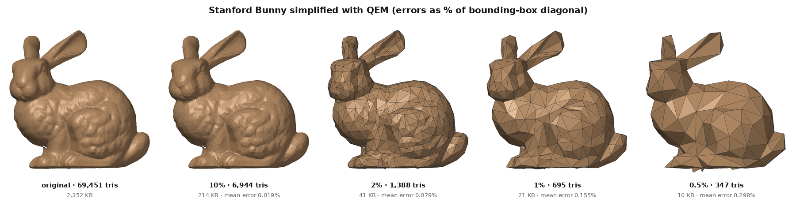

**Live demo:** <https://daksha1611.github.io/meshkit/>. Drag a slider through the levels of detail
of the bunny, Spot and Fandisk in 3D.

## Headline results

| Result | Value |
|---|---|
| Stanford Bunny at 2% of its triangles | 69,451 → 1,389 triangles, 2,352 KB → 41 KB (98.3% smaller) |
| Shape change at 2% | mean error 0.079%, max error 0.675% of the bounding-box diagonal |
| QEM vs vertex clustering, same triangle count | 3.0× to 4.6× lower mean error for QEM (368 to 14,421 triangles) |
| Simplify then subdivide | bunny at 1% (695 triangles) + 2 Loop levels → 11,120 triangles; mean error 0.156% → 0.352% |
| Loop subdivision of an icosahedron | radius spread 1.36%, 0.89%, 0.80% after 1, 2, 3 levels |

All numbers come from [`results/summary.json`](results/summary.json) and the CSV files next to
the images, written by `run_experiments.py`.

## The problem

3D models from scanners and artists often have hundreds of thousands of triangles, but phones,
browsers, games and VR headsets cannot draw that many quickly, and the files are slow to download.
The usual answer is level of detail (LOD): keep several simpler versions of each model and draw
a simpler one when the object is small on screen. The hard part is removing triangles
without changing the shape, and measuring how much the shape did change.

## How it works

**QEM simplification** (Garland & Heckbert 1997), in [`mesh/simplify.py`](mesh/simplify.py) and
[`mesh/quadrics.py`](mesh/quadrics.py):

1. Each triangle lies in a plane. A 4×4 matrix K = p pᵀ measures the squared distance of any point
   to that plane. Each vertex adds up the K of its triangles into one matrix Q.
2. For every edge, find the point where the merged vertex would have the least error under
   Q₁ + Q₂ (a 3×3 linear solve, with a fallback when the system is nearly singular), and its cost.
3. Put all edges in a priority queue and repeatedly collapse the cheapest one: two vertices become
   one, two triangles disappear.
4. The merged vertex keeps Q₁ + Q₂, so it still "remembers" every original plane. The edges
   around it are re-costed; old queue entries are skipped lazily using version numbers.
5. Two checks reject a collapse that would break the mesh: the *link condition* (no pinches,
   Euler number unchanged) and the *fold check* (no triangle turns over).

**Loop subdivision** (Loop 1987), in [`mesh/subdivide_loop.py`](mesh/subdivide_loop.py):

1. Put a new point on every edge: 3/8 of each end plus 1/8 of each opposite corner.
2. Move every old vertex towards the average of its neighbours (Warren's weights).
3. Split every triangle into four. Repeat for more levels; the limit is a smooth surface.

**Error measurement**, in [`mesh/metrics.py`](mesh/metrics.py): scatter 30,000 random points on each
surface, measure each point's distance to the other surface (exact point-to-triangle distance),
and report the mean and the maximum (an estimate of the Hausdorff distance) as a percentage of
the bounding-box diagonal.

## Results gallery

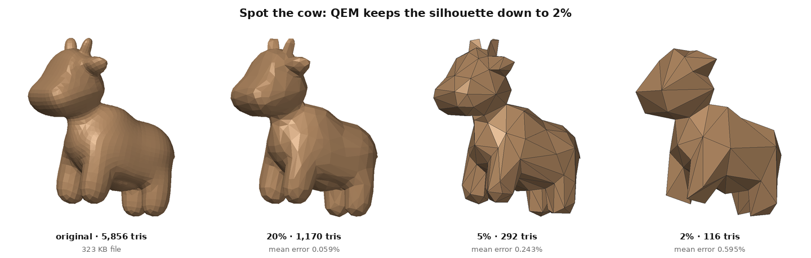
Spot the cow: mean error 0.059%, 0.243% and 0.618% at 20%, 5% and 2%.

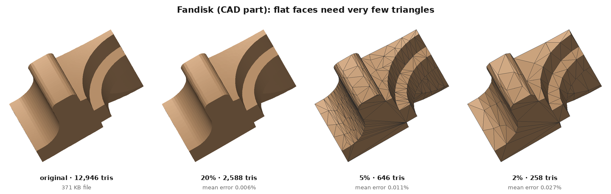
Fandisk, a CAD part: large flat faces need very few triangles (mean error 0.027% at 2%).

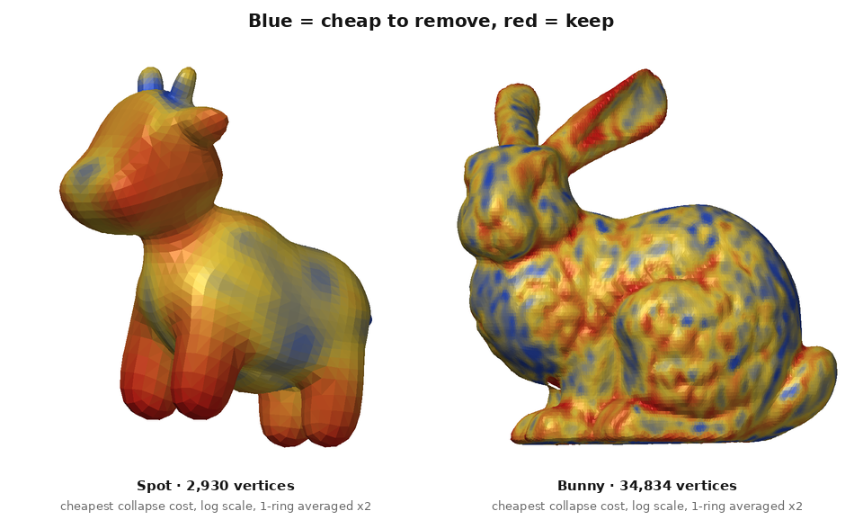
Each vertex coloured by its cheapest collapse cost, the value the priority queue sorts by
(log scale; averaged twice with neighbouring vertices for display only).

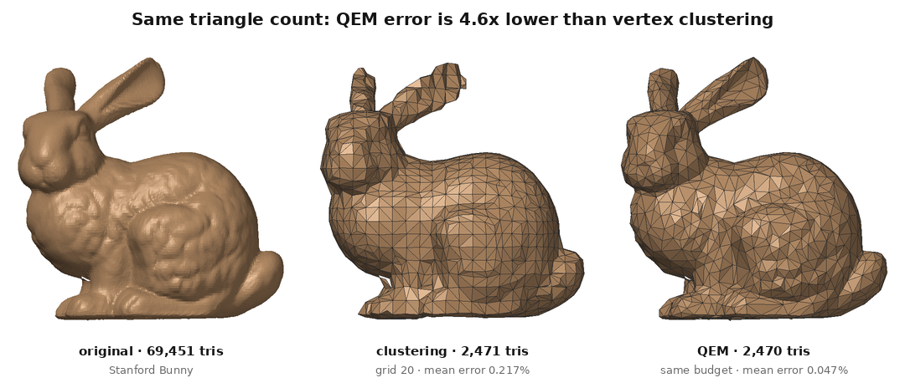
Same triangle budget: vertex clustering (middle) against QEM (right).

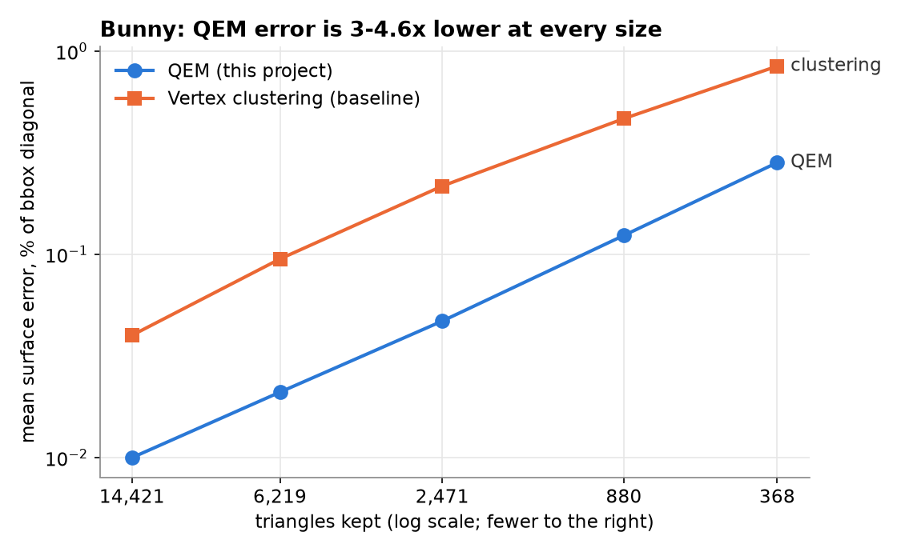
QEM against the clustering baseline at five sizes ([`comparison.csv`](results/04_qem_vs_clustering/comparison.csv)).

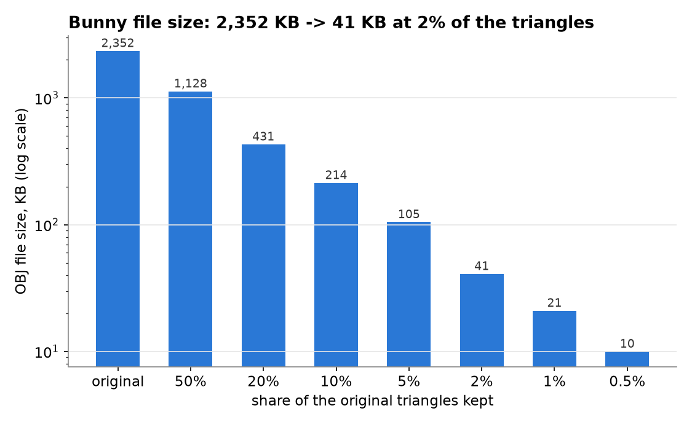
OBJ file size of every bunny level ([`metrics.csv`](results/01_bunny_lod/metrics.csv)).

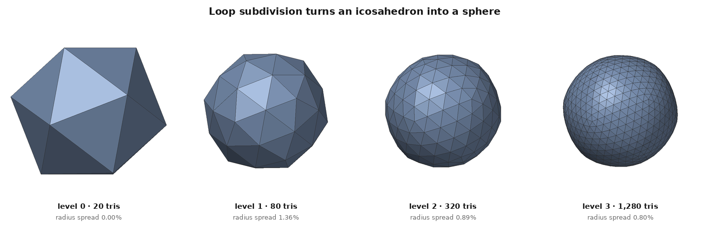
Loop subdivision turns an icosahedron into a sphere.

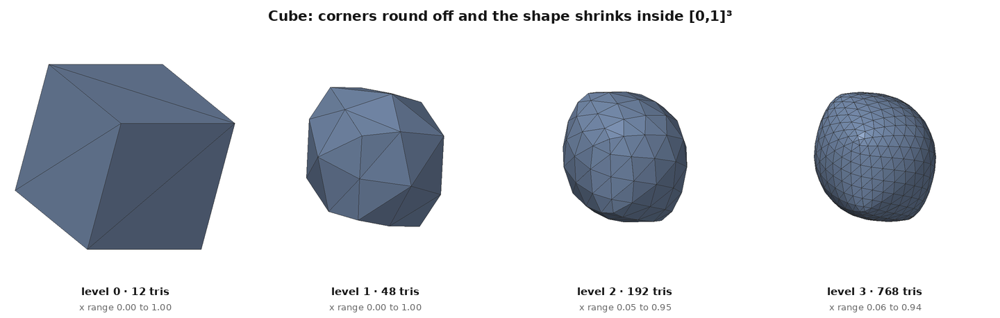
A cube rounds off and shrinks inside its original box (the x range is in each caption): Loop approximates its control
mesh instead of passing through it. The shape is lopsided because of how the 12-triangle cube is
split: two opposite corners touch 6 edges and the other six corners touch 4, so Loop's weights
pull them differently.

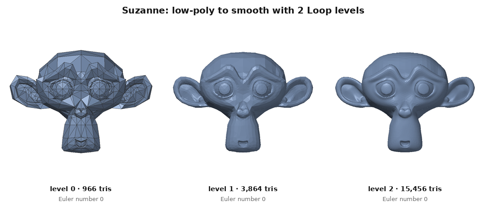
Suzanne from Blender, after removing one doubled triangle in the source file ([DEVLOG](DEVLOG.md)).

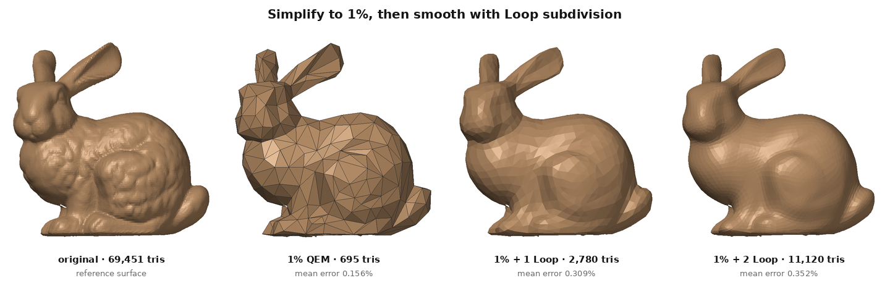
Simplify to 1%, then smooth: the surface looks better but moves further from the original.

## What changes when...

Each ablation changes one setting and keeps the model, view and measurement the same. Full tables,
images and explanations: [`results/07_ablations/README.md`](results/07_ablations/README.md).

| Experiment | Change | Result |
|---|---|---|
| A1 fold check (bunny 1%) | on → off | turned-over faces 0.29% → 2.59%; mean error 0.156% → 0.148% (distance cannot see flips) |
| A2 boundary quadrics (bunny 2%) | weight 1000 → 0 | holes in the base grow (rim length 101.2% → 112.6% of the original); max error 0.675% → 4.375% |
| A3 area weighting (Spot 2%) | on → off | horns survive without it; mean error 0.618% → 0.715%, max error 5.088% → 4.053% |
| A4 vertex placement (bunny 1%) | optimal / midpoint / endpoint | mean error 0.156% / 0.421% / 0.265% |
| A5 fold threshold (bunny 1%) | −1 / 0 / 0.2 / 0.5 | turned-over faces 2.59% / 0.43% / 0.29% / 0.14%; mean error 0.148% to 0.156% |
| A6 Loop levels after simplifying (bunny 1%) | 0 / 1 / 2 / 3 | mean error 0.156% / 0.308% / 0.352% / 0.362% |

## Quick start

```bash
python3 -m venv .venv && source .venv/bin/activate
pip install -r requirements.txt

python meshkit.py info models/stanford-bunny.obj
python meshkit.py simplify models/stanford-bunny.obj -o out/bunny_2.obj --ratio 0.02
python meshkit.py subdivide out/bunny_2.obj -o out/bunny_smooth.obj --levels 2
python meshkit.py render out/bunny_2.obj -o out/bunny_2.png --wire

python -m pytest -q tests          # 26 tests
python run_experiments.py          # regenerates results/ and docs/data (about 6 minutes)
```

The simplify command prints, for example:

```text
69451 -> 1389 triangles (2.00%) in <seconds, depends on the machine>s
mean error 0.079% , max error 0.675% of bbox diagonal
file 2352 KB -> 41 KB
```

Only NumPy, SciPy (its k-d tree, used only to find nearest points when measuring error), Matplotlib,
Pillow and pytest are used: loading, simplification, subdivision, error measurement and rendering
are all written in this repository.

## Project structure

```text
meshkit.py              command-line tool
run_experiments.py      regenerates results/, results/summary.json and docs/data
mesh/obj_io.py          OBJ reading/writing, merging duplicate vertices
mesh/mesh.py            edges, boundary, Euler characteristic, normals, areas
mesh/quadrics.py        quadric error metrics and the optimal vertex position
mesh/simplify.py        greedy edge collapse with a priority queue; vertex clustering baseline
mesh/subdivide_loop.py  Loop subdivision
mesh/metrics.py         surface sampling, point-to-triangle distance, two-sided error
render/renderer.py      software renderer used for every result image
tests/                  26 pytest tests
docs/                   GitHub Pages site (three.js viewer)
results/                images, CSV tables and summary.json
scripts/                model download and the results-PR helper
```

### How it connects to the course

| Lecture topic | Where the project uses it |
|---|---|
| Polygon meshes (vertex, edge, face lists) | `mesh/mesh.py` builds edge lists and vertex→face tables from the face list |
| Quadric surfaces | a QEM quadric is a quadratic form vᵀQv in homogeneous coordinates |
| Splines, B-splines | Loop's boundary rule is the cubic B-spline refinement rule; on a regular mesh the Loop limit surface is a quartic box spline, a 2D relative of B-splines |
| 2D/3D transformations, homogeneous coordinates | `render/renderer.py` rotation Rz·Ry·Rx; planes as 4-vectors [a, b, c, d] |
| Viewing pipeline, window-to-viewport | orthographic projection and fitting the model's box to 88% of the image |
| Lighting (ambient, diffuse, specular) | two-light diffuse plus Blinn-Phong specular per face |
| Flat / Gouraud / Phong shading | flat shading in the renderer; flat vs smooth toggle in the web viewer |
| Back-face culling, painter's algorithm | used to draw every result image |
| Raster displays, polygon fill, anti-aliasing | projected triangles are filled into a raster image at 2× size (Pillow does the polygon fill), then filtered down |

## Tests

`python -m pytest -q tests` runs 26 tests:

- **OBJ files (3):** save/load round trip; `f 1/1/1` tokens and quad splitting; duplicate vertices merged.
- **Simplification (12):** Euler number kept at 50/10/2%; no degenerate or duplicate faces at 50/10/2%;
  `target_faces=500` gives 490 to 500; ratio 1.0 changes nothing; a flat grid collapses to at most
  8 triangles and stays flat; over 80% of Spot's simplified normals point outward; error grows as
  triangles are removed; QEM beats clustering at equal size.
- **Subdivision (6):** face and vertex counts; 20 → 1,280 faces in 3 levels; Euler number kept;
  icosahedron radius spread under 1%; flat grid stays flat; subdivided cube stays inside [0,1]³.
- **Metrics (5):** self-error is zero; a 1% shift is measured correctly; closest point for the
  face, vertex and edge regions; samples lie on the surface; Spot is closed.

GitHub Actions runs them on Python 3.10, 3.11 and 3.12 for every push and pull request.
A second workflow, `results.yml`, re-runs the experiments whenever the algorithm code changes and
opens a pull request with the new images, so GitHub's image diff (2-up, swipe, onion skin) shows
exactly how the output changed. Timings in the CSV files depend on the machine that last ran the script.

The development log, with the bugs and surprises met along the way, is in [DEVLOG.md](DEVLOG.md).

## References

- M. Garland, P. S. Heckbert. *Surface Simplification Using Quadric Error Metrics.* SIGGRAPH 1997.
- M. Garland, P. S. Heckbert. *Simplifying Surfaces with Color and Texture using Quadric Error Metrics.* IEEE Visualization 1998.
- H. Hoppe. *Progressive Meshes.* SIGGRAPH 1996.
- J. Rossignac, P. Borrel. *Multi-resolution 3D approximations for rendering complex scenes.* 1993.
- C. Loop. *Smooth Subdivision Surfaces Based on Triangles.* MS thesis, University of Utah, 1987.
- E. Catmull, J. Clark. *Recursively Generated B-spline Surfaces on Arbitrary Topological Meshes.* Computer-Aided Design, 1978.
- C. Ericson. *Real-Time Collision Detection.* Morgan Kaufmann, 2004 (closest point on a triangle).
- Hearn & Baker, *Computer Graphics*; Foley, van Dam, Feiner, Hughes, *Computer Graphics: Principles and Practice*.

Test models from [common-3d-test-models](https://github.com/alecjacobson/common-3d-test-models);
original sources and licence notes in [models/SOURCES.md](models/SOURCES.md). Code: MIT licence.
