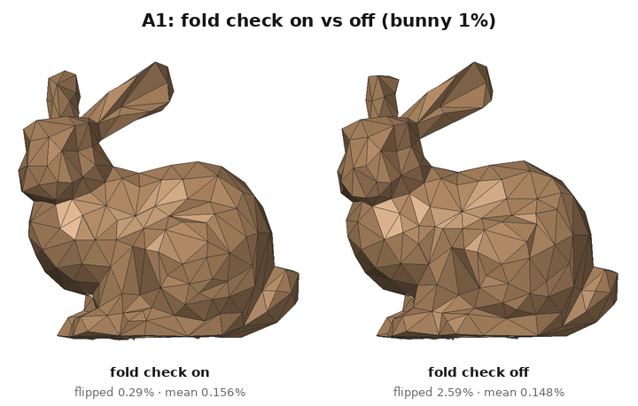
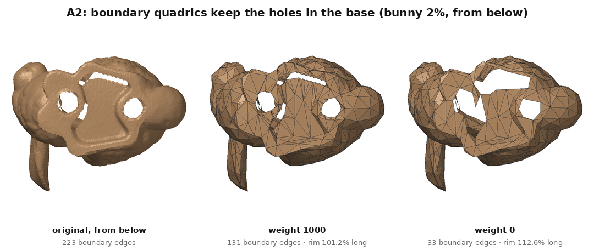
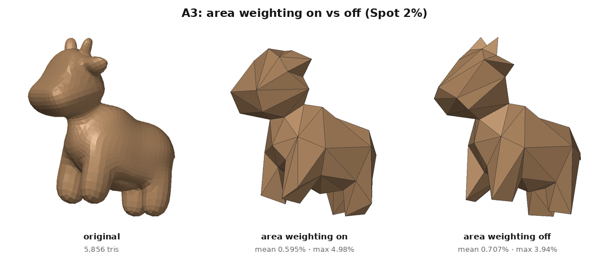
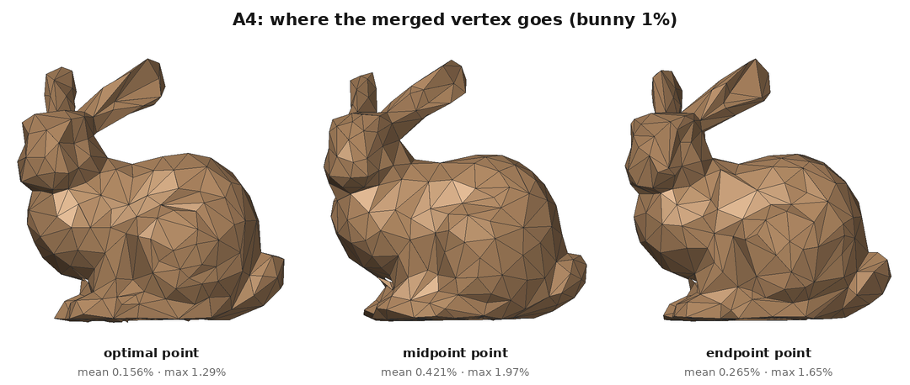
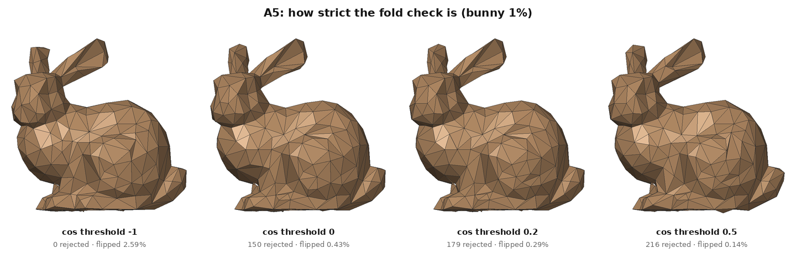
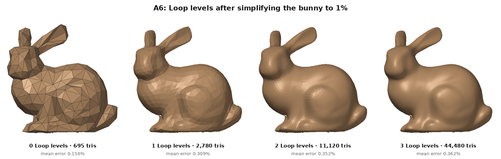

# Ablation study: what changes when one part of the algorithm is switched off

Each experiment changes exactly one setting, renders the same model from the same
camera, and measures it in the same way (`ablations.csv`; errors are % of the
bounding-box diagonal; "flipped" = new faces whose normal points opposite to the
nearest original face). This file is written by `run_experiments.py`.

## A1: fold check (bunny 1%)

| variant | triangles | mean error % | max error % | flipped faces % | rejected flip |
|---|---|---|---|---|---|
| fold check on | 695 | 0.156 | 1.288 | 0.29 | 179 |
| fold check off | 694 | 0.148 | 1.084 | 2.59 | 0 |

Without the fold check, 2.59% of the faces end up turned over, against
0.29% with it. The mean error does not get worse (0.156% on,
0.148% off): the distance measure only asks how far the new surface is from the
old one, not which way it faces, so a turned-over triangle lying near the surface costs almost
nothing. That is why the fold check compares normals instead of distances.

## A2: boundary quadrics (bunny 2%, seen from below)

| variant | triangles | mean error % | max error % | flipped faces % | boundary edges | boundary length vs original % |
|---|---|---|---|---|---|---|
| boundary weight 1000 | 1389 | 0.08 | 0.675 | 0.29 | 131 | 101.2 |
| boundary weight 0 | 1389 | 0.085 | 4.375 | 0.07 | 33 | 112.6 |

With weight 0 nothing stops the rim vertices of the holes from sliding, so the holes in the base
grow (the rim is 112.6% as long as the original, drawn with only
33 edges) and the max error rises from 0.675% to 4.375%.
The extra planes along each boundary edge make sliding off the rim expensive, so with weight 1000
the rim stays at 101.2% of its original length.

## A3: area weighting (Spot 2%)

| variant | triangles | mean error % | max error % | flipped faces % |
|---|---|---|---|---|
| area weighting on | 116 | 0.595 | 4.984 | 0.86 |
| area weighting off | 116 | 0.707 | 3.945 | 0.0 |

With area weighting on, the horns disappear at 2%: they are built from many tiny triangles, and
quadrics scaled by tiny areas make them cheap to remove. With it off every triangle counts the
same, so the horns survive (visible as two spikes), but the large body pays for it: the mean
error rises from 0.595% to 0.707% while the max error falls from
4.984% to 3.945% (with weighting on, the worst point is at the horn tips).

## A4: where the merged vertex goes (bunny 1%)

| variant | triangles | mean error % | max error % | flipped faces % | rejected flip |
|---|---|---|---|---|---|
| optimal | 695 | 0.156 | 1.288 | 0.29 | 179 |
| midpoint | 695 | 0.421 | 1.974 | 0.72 | 112 |
| endpoint | 695 | 0.265 | 1.652 | 0.29 | 1026 |

The optimal point has the lowest error (0.156% mean) because it is chosen to stay
close to all the original planes at once. The midpoint is worst (0.421%): on a
curved surface the middle of an edge lies inside or outside the surface; the better end point
(0.265%) at least keeps a vertex that was on the original surface.

## A5: how strict the fold check is (bunny 1%)

| variant | triangles | mean error % | max error % | flipped faces % | rejected flip |
|---|---|---|---|---|---|
| threshold -1 | 694 | 0.148 | 1.084 | 2.59 | 0 |
| threshold 0 | 695 | 0.155 | 1.184 | 0.43 | 150 |
| threshold 0.2 | 695 | 0.156 | 1.288 | 0.29 | 179 |
| threshold 0.5 | 694 | 0.156 | 1.088 | 0.14 | 216 |

A collapse is rejected when a face's normal turns so far that cos(old, new) falls below the
threshold. Raising it from -1 (off) to 0.5 rejects 0 -> 216
collapses and lowers the flipped faces from 2.59% to 0.14%,
while the mean error stays between 0.148% and 0.156%.

## A6: Loop subdivision after simplification (bunny 1%)

| variant | triangles | mean error % | max error % | flipped faces % |
|---|---|---|---|---|
| 0 Loop levels | 695 | 0.156 | 1.288 | 0.29 |
| 1 Loop levels | 2780 | 0.309 | 1.887 | 0.29 |
| 2 Loop levels | 11120 | 0.352 | 2.168 | 0.18 |
| 3 Loop levels | 44480 | 0.362 | 2.27 | 0.13 |

Each Loop level multiplies the triangles by 4 and makes the surface look smooth, but the mean error
grows from 0.156% (0 levels) to 0.362% (3 levels). Loop subdivision
approximates its control mesh instead of passing through it, so it moves the vertices that QEM
placed on the surface (on convex parts it pulls them inwards): smoother is not the same as closer
to the original.
